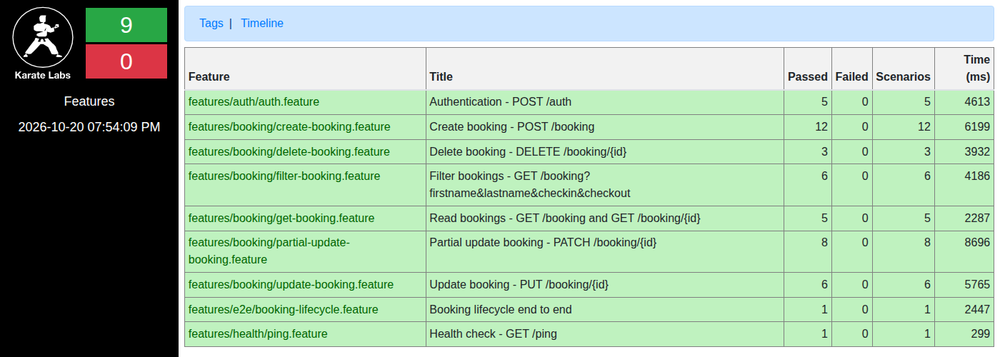

# Karate API Tests — Restful Booker

[](https://github.com/anavastech/karate-restful-booker-api-tests/actions/workflows/api-tests.yml)
[](https://github.com/karatelabs/karate)
[](https://adoptium.net/)
[](LICENSE)

📊 **Latest test report:** https://anavastech.github.io/karate-restful-booker-api-tests/

API test automation suite for [Restful Booker](https://restful-booker.herokuapp.com/apidoc/index.html), built with
**Karate** and **JUnit 5**. It covers every endpoint of the API with functional, negative, contract, data-driven and
end-to-end tests, runs in parallel on GitHub Actions every day, and publishes the HTML report to GitHub Pages.

Restful Booker is a public hotel-booking API created for practising API testing. **It ships with intentional bugs**, so
part of this project documents them as findings (see [Findings](#findings)).

---

## Tech stack

| Tool | Purpose |
|---|---|
| Java 17 + Maven | Build and dependency management |
| [Karate 1.5.2](https://github.com/karatelabs/karate) (`io.karatelabs`) | API testing DSL, assertions, schema matching, reports |
| JUnit 5 | Test runner (parallel execution) |
| GitHub Actions | CI on push / PR / daily schedule / manual dispatch |
| GitHub Pages | Hosting of the Karate HTML report |

## Project structure

```
.
├── .github/workflows/api-tests.yml      # CI pipeline + report publishing
├── pom.xml
└── src/test/java
    ├── karate-config.js                 # baseUrl, credentials, timeouts per environment
    ├── logback-test.xml                 # quiet console, full HTTP log in target/karate.log
    ├── runners/TestRunner.java          # parallel JUnit 5 runner with tag filtering
    ├── common
    │   ├── auth.feature                 # reusable token helper (callonce)
    │   ├── create-booking.feature       # reusable test-data helper
    │   ├── basic-auth.js                # Basic auth header builder
    │   ├── data/                        # payload template, data generator, data-driven sets
    │   └── schemas/                     # fuzzy-match contracts (booking, created booking, token, id)
    └── features
        ├── health/ping.feature
        ├── auth/auth.feature
        ├── booking/                     # get, create, update, partial-update, delete, filter
        └── e2e/booking-lifecycle.feature
```

## Design decisions

- **Observed behaviour vs. correct behaviour.** Regression scenarios assert what the API *actually* does today, which
  was verified manually with `curl` before writing any test. Where that behaviour is wrong, a separate `@bug` scenario
  asserts the *correct* behaviour and is therefore expected to fail. `@bug` scenarios are excluded from the default run
  and from CI. If the API is ever fixed, the regression test fails and the `@bug` test passes, which is a clear signal
  to update the suite.
- **Independent, parallel-safe tests.** Each scenario creates its own booking through `common/create-booking.feature`,
  using UUID-suffixed names and dates relative to today (`data-generator.js`). No scenario depends on another one or on
  seeded data, which matters because the public API **resets itself periodically** and the suite runs on 5 threads.
- **Reusable contracts.** Response schemas live in `common/schemas/` as Karate fuzzy matchers (`#string`, `#number`,
  `#boolean`, `##string` for optional fields, `#regex` for ISO dates) and are reused across features.
- **Data-driven tests.** Valid and invalid payloads are kept in JSON files and fed into dynamic `Scenario Outline`s
  (`Examples: | read('...json') |`), so adding a case means adding a JSON object, not a scenario.
- **Authentication.** The token is fetched once per feature with `callonce`. Both supported auth modes are covered:
  `Cookie: token=<token>` and `Authorization: Basic`.
- **Side effects are verified.** Rejected `PUT`/`PATCH`/`DELETE` calls are followed by a `GET` that proves the booking
  was not modified or deleted, and a successful `DELETE` is confirmed with a `404`.
- **No hard-coded configuration.** Base URL, credentials and the response-time threshold come from
  `karate-config.js` and can be overridden with system properties or environment variables.
- **Response time.** Smoke scenarios assert `responseTime < maxResponseTime` (5000 ms by default). The API runs on a
  shared Heroku dyno with occasional latency spikes, so the threshold is deliberately tolerant and configurable.

## Running locally

**Prerequisites:** JDK 17+ and Maven 3.8+.

```bash
# Full suite (everything except @bug)
mvn test

# By tag (comma = OR)
mvn test -Dtags=@smoke
mvn test -Dtags=@negative
mvn test -Dtags=@smoke,@e2e

# Run the known API defects (expected to fail)
mvn test -Dtags=@bug

# Choose the environment and parallelism
mvn test -Dkarate.env=local -Dthreads=3
```

The report is written to `target/karate-reports/karate-summary.html`.

### Environments and overrides

| Setting | System property | Environment variable | Default |
|---|---|---|---|
| Environment | `-Dkarate.env` | — | `dev` |
| Base URL | `-DbaseUrl` | `RB_BASE_URL` | `dev`: `https://restful-booker.herokuapp.com` · `local`: `http://localhost:3001` |
| Username | `-Dusername` | `RB_USERNAME` | `admin` |
| Password | `-Dpassword` | `RB_PASSWORD` | `password123` |
| Max response time (ms) | `-DmaxResponseTime` | `RB_MAX_RESPONSE_TIME` | `5000` |

To run against a local instance: `docker run -p 3001:3001 mwinteringham/restfulbooker`, then
`mvn test -Dkarate.env=local`.

### Tags

| Tag | Meaning |
|---|---|
| `@smoke` | Critical, fast checks (one happy path per endpoint + E2E) |
| `@regression` | Full suite |
| `@negative` | Invalid input, missing or invalid auth, non-existent resources |
| `@e2e` | Complete booking lifecycle |
| `@bug` | Documents a real API defect by asserting the correct behaviour; **fails by design**, excluded by default |

## CI/CD

The [workflow](.github/workflows/api-tests.yml) runs on every push and pull request to `main`, daily at 06:00 UTC, and
on demand (**Actions → API Tests → Run workflow**), where you can choose which tag to run. It:

1. Sets up Temurin JDK 17 with a Maven cache.
2. Runs the suite (`@bug` excluded).
3. Uploads `target/karate-reports` as a build artifact.
4. Publishes the HTML report to GitHub Pages (on `main`, also when tests fail, so the report shows what broke).

## Test coverage

47 regression scenarios + 20 `@bug` scenarios.

| Endpoint | Scenarios covered |
|---|---|
| `GET /ping` | Health check responds (status, body, response time) |
| `POST /auth` | Valid credentials return a token (contract) · wrong password, unknown user, empty credentials, empty body return no token · 🐞 invalid login should be 401 |
| `GET /booking` | List contract (`[{ bookingid }]`) |
| `GET /booking?…` | Filter by firstname + lastname, by lastname only, no matches → `[]`, date range that contains the booking, date ranges that exclude it · 🐞 `checkin` filter should be inclusive |
| `GET /booking/{id}` | Existing booking (contract + exact data + content type) · non-existent ids (`2147483647`, `0`, `abc`) → 404 |
| `POST /booking` | Response contract · persisted and retrievable · `additionalneeds` optional · data-driven outline with 4 valid data sets · 5 missing required fields are rejected · 🐞 12 invalid payloads (missing fields, wrong types, invalid dates, negative price, checkout before checkin) should be 400 · 🐞 empty body should be 400 · 🐞 creation should return 201 |
| `PUT /booking/{id}` | Update with cookie token (verified with GET) · update with Basic auth · no token / invalid token / wrong Basic password → 403 and booking unchanged · incomplete body → 400 · 🐞 non-existent id should be 404 |
| `PATCH /booking/{id}` | Patch several fields keeps the rest · data-driven outline patching each field, including nested `bookingdates` · no token / invalid token → 403 and booking unchanged · 🐞 non-existent id should be 404 |
| `DELETE /booking/{id}` | Delete with token, then GET → 404 · no token / invalid token → 403 and booking still exists · 🐞 success should be 200/204 · 🐞 deleting twice should be 404 |
| E2E | Auth → create → read → update → partial update → delete → confirm 404 |

## Findings

Unexpected behaviour found while exploring the API (manually with `curl`, then automated). Items with a 🐞 are covered
by a failing `@bug` scenario.

| # | Request | Expected (REST good practice / docs) | Actual | Test |
|---|---|---|---|---|
| 1 | `POST /auth` with wrong credentials or an empty body | `401 Unauthorized` | `200 OK` with `{"reason":"Bad credentials"}` | 🐞 |
| 2 | `POST /booking` (success) | `201 Created` (+ `Location` header) | `200 OK` | 🐞 |
| 3 | `POST /booking` missing a required field, with an empty body, or with a numeric `firstname` | `400 Bad Request` with a validation message | `500 Internal Server Error` | 🐞 |
| 4 | `POST /booking` with `"totalprice": "one hundred"` | `400` | `200`, stored as `"totalprice": null` | 🐞 |
| 5 | `POST /booking` with `"depositpaid": "yes"` | `400` | `200`, silently coerced to `true` | 🐞 |
| 6 | `POST /booking` with `"checkin": "not-a-date"` | `400` | `200`, stored as `"0NaN-aN-aN"` | 🐞 |
| 7 | `POST /booking` with `"checkin": "2030-02-30"` | `400` | `200`, silently rolled over to `2030-03-02` | 🐞 |
| 8 | `POST /booking` with checkout before checkin, or a negative `totalprice` | `400` | `200`, accepted | 🐞 |
| 9 | `PUT` / `PATCH` / `DELETE` on a non-existent id (including deleting twice) | `404 Not Found` | `405 Method Not Allowed` | 🐞 |
| 10 | `DELETE /booking/{id}` (success) | `200 OK` or `204 No Content` | `201 Created` | 🐞 |
| 11 | `GET /booking?checkin=YYYY-MM-DD` | Docs: checkin **≥** date | Checkin **>** date (bookings starting that day are excluded) | 🐞 |
| 12 | `GET /booking?checkout=YYYY-MM-DD` | Docs: checkout **≥** date | Checkout **≤** date (docs and implementation disagree) | — |
| 13 | `GET /ping` | `200 OK` | `201 Created` | — |
| 14 | `PUT` / `PATCH` / `DELETE` without credentials | `401 Unauthorized` (no credentials) | `403 Forbidden` for both missing and invalid tokens | — |
| 15 | `POST /booking` with `Accept: application/xml` | `Content-Type: application/xml` | XML body served as `Content-Type: text/html` | — |
| 16 | Any error response | Structured JSON error | Plain-text body (`Not Found`, `Forbidden`, …) | — |

## Report



## License

[MIT](LICENSE)
